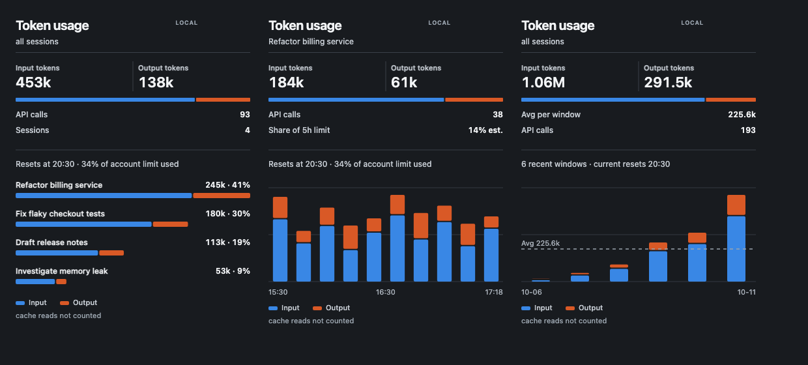
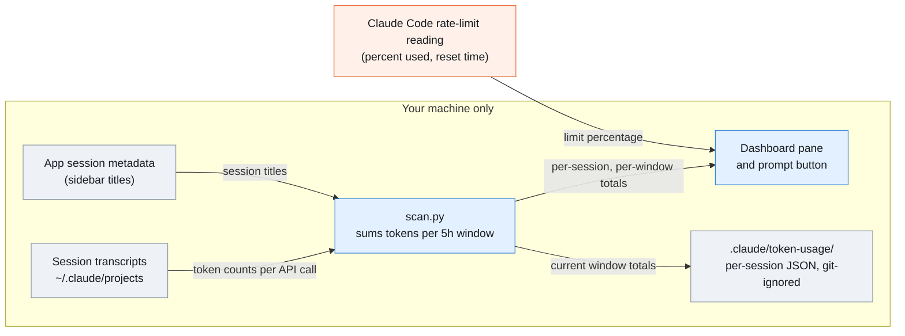

# token-window

A Claude Code mod that shows how many input and output tokens you have used in the current 5-hour rate-limit window, split by session.



## What you get

- A button above the prompt with the live count. Click it to open the dashboard pane.
- Input and output tokens for the window, plus API calls and your estimated share of the 5-hour limit.
- A **Show** dropdown: all sessions, or one session by its sidebar title.
- A **Range** dropdown: last 5 hours, last 5 windows, or last 10 windows, with an average line.
- A narrow, single-column layout that follows the pane width and follows light or dark mode.
- A small JSON file per active session in `.claude/token-usage/` of the project you are in. The folder ignores itself, so nothing reaches git.

## Install

In a Claude Code terminal session:

```
/plugin install token-window --marketplace pokhriyal-anmol/claude-token-window
```

Answer `y` to add the marketplace, then pick the user scope. Restart the session if the pane does not appear. Open it with `/tokens` or the button above the prompt.

Requires `python3` on your PATH.

## How it works



The mod reads transcripts that Claude Code already writes to disk. Nothing is sent anywhere. A 5-hour window opens at the first call after the previous one closed, which approximates how plan limits are counted.

## Notes and limits

- Token counts come from transcripts. They are not Anthropic billing figures.
- The share of the 5-hour limit for one session is estimated from the account-level percentage and that session's share of the window.
- Input is fresh input plus cache writes. Cache reads are shown separately and not counted.
- Each refresh rescans the last 14 days of transcripts. That takes well under a second for a typical setup.
- Colors follow your operating system theme.

## Develop

```
claude plugin validate .
claude --plugin-dir .
```

The hooks module is `hooks/register.tsx`, the scanner is `hooks/scan.py`, and the shared state contract is `types/index.d.ts`.

## License

MIT
